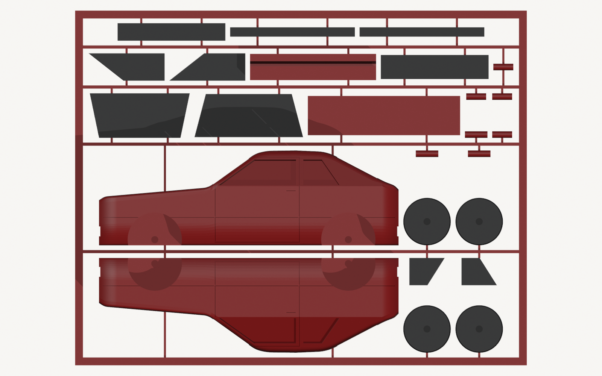

# Impressão 3D – Carros em Kit Card

Miniaturas de carros no estilo **kit card**: todas as peças saem impressas presas numa moldura, como os antigos kits de plastimodelismo. É só destacar e montar, sem cola na maior parte das peças.

Primeiro modelo: **VW Gol 1980 (1ª geração), vermelho, escala 1:32** (~12 cm), feito para a **Bambu Lab A1 mini + AMS lite**.

| Montado | Traseira |
|---|---|
|  |  |

| O cartão como sai da impressora | Vista de cima do cartão |
|---|---|
|  |  |

> **Status: versão 1, ainda não impressa.** Falta imprimir a plaquinha de teste de folgas e o primeiro cartão para validar os encaixes.

---

## Para imprimir (atalho)

1. Imprima **[`saida/teste_folgas.stl`](saida/teste_folgas.stl)** (1 cor, ~10 min). Veja em qual furo (10, 15, 20, 25 ou 30) o pino entra **firme, com pressão de dedo**. Esse número, dividido por 100, vai em `HOLE_EXTRA` no `gol_kitcard.py` (o padrão é 0,20).
2. Abra **[`saida/gol_kitcard_A1mini.3mf`](saida/gol_kitcard_A1mini.3mf)** no Bambu Studio. Ele já vem fatiado e com as cores atribuídas.
3. Configure os slots do AMS assim:

| Slot | Cor | Peças |
|---|---|---|
| 1 | Vermelho | carroceria, moldura, plaquinha, pinos, lanternas |
| 2 | Preto | pneus, vidros, frente, painel traseiro, para-choques |
| 3 | Prata | calotas, frisos da grade, face dos para-choques |
| 4 | Branco | faróis e placas |

**Estimativa do Bambu Studio** (PLA Basic, 0,20 mm Standard, mesa texturizada):

| | |
|---|---|
| Tempo | **2h47** |
| Filamento | **~76 g** (65 g vermelho, 9,4 g preto, 0,7 g prata, 0,7 g branco) |
| Trocas de cor | 30 |
| Tamanho do cartão | 172 × 135 mm (sobra espaço para a torre de purga na A1 mini) |

---

## Como foi feito

### 1. Pesquisa

**Referência de estilo:** um kit card do B-17 Flying Fortress. Dele vieram as ideias da fuselagem dividida em duas metades deitadas sobre a face de corte, das peças presas por canais e pontos de destaque e da plaquinha com o nome.

**Medidas do carro real** (VW Gol L 1.3, 1980, [ficha técnica](https://www.fichacompleta.com.br/en/carros/volkswagen/gol-l-1-3-1980)):

| Medida | Real | Na escala 1:32 |
|---|---|---|
| Comprimento | 3790 mm | 118,4 mm |
| Largura | 1601 mm | 50,0 mm |
| Altura | 1375 mm | 43,0 mm |
| Entre-eixos | 2358 mm | 73,7 mm |
| Bitola dianteira / traseira | 1350 / 1366 mm | 42,2 / 42,7 mm |
| Vão livre do solo | 145 mm | 4,5 mm |
| Pneu 155/80 R13 (Ø ≈ 578 mm) | 155 mm de largura | Ø 18,1 × 4,8 mm |

**Impressora** ([especificações A1 mini](https://bambulab.com/en/a1-mini/tech-specs)): mesa de 180 × 180 × 180 mm e AMS lite de 4 cores. Isso limitou o cartão a no máximo ~172 mm de largura, deixando espaço para a torre de purga.

**Formas que não constam na ficha técnica** (perfil lateral, inclinação do para-brisa e da tampa traseira, largura do teto, posição das portas e janelas): estimadas a partir de fotos do Gol "bola" de 1ª geração, com as medidas oficiais como base.

### 2. Software usado (tudo gratuito)

| Software | Versão | Para quê |
|---|---|---|
| **Blender** | 5.0.1 | Modelagem 3D. Roda **em segundo plano por script Python**, sem abrir a interface |
| **Python + NumPy** | o que vem com o Blender | Cálculo do perfil, das seções e das peças |
| **Bambu Studio** | 2.05 | Fatiamento pela linha de comando: gera o `.3mf` com as cores e as estimativas de tempo e peso |
| Motor booleano **Manifold** | embutido no Blender 5 | Cortes (furos, rebaixos, vincos) sempre com malhas fechadas e prontas para imprimir |

**Por que por script, e não modelando com o mouse:**
- **Medidas exatas:** folgas, espessuras e encaixes ficam com precisão de décimo de milímetro.
- **Ajuste rápido:** mudar a escala, a folga dos pinos ou o texto da plaquinha é trocar um número no topo do arquivo e rodar de novo.
- **Tudo regenerado junto:** o mesmo script gera as peças, monta o cartão, cria os pontos de destaque, confere se as malhas estão fechadas, exporta os STL e faz os renders.

### 3. Como o modelo é construído (`gol_kitcard.py`)

1. **Perfil lateral:** uma linha poligonal com os pontos-chave (bico, capô, base e topo do para-brisa, teto, vidro traseiro, traseira), com os cantos arredondados.
2. **Seções transversais:** a cada 1 cm do carro real (366 seções), o script calcula a meia-seção da carroceria:
   - assoalho;
   - lateral com a curva de baixo;
   - linha de cintura;
   - janelas inclinadas para dentro ("tumblehome");
   - canto arredondado;
   - teto levemente abaulado.
3. **Loft:** as seções são costuradas numa malha sólida. Só a metade esquerda é modelada; a direita é o espelho dela.
4. **Detalhes por corte booleano:**
   - caixas de roda e furos dos eixos;
   - furos dos pinos na face de corte;
   - rebaixos para o para-brisa, o vidro traseiro, os vidros laterais, a frente, o painel traseiro e os para-choques;
   - vincos das portas, friso lateral e maçaneta, que acompanham a curvatura da lateral.
5. **Peças avulsas:**
   - 4 rodas (pneu preto e calota prata com anel);
   - 6 vidros;
   - frente (grade preta, faróis brancos, frisos prata);
   - painel traseiro (lanternas vermelhas, placa branca);
   - 2 para-choques;
   - plaquinha "GOL 1980" com pezinho;
   - 7 pinos.
6. **Cartão:**
   - As peças são giradas para a posição de impressão e distribuídas em linhas (as pequenas são empilhadas).
   - O script cria a moldura, as barras e os pontos de destaque (0,8 × 0,8 mm). A posição de cada ponto é calculada por raio até tocar a peça.

### 4. Decisões de projeto

- **Fundo do cartão 100% plano e sem suporte.** As metades da carroceria deitam sobre a face de corte. Como a superfície externa sempre "olha para cima", não existe nenhum balanço.
- **Menos trocas de cor, mais lucro.** Cada troca no AMS gasta filamento e tempo. Por isso:
  - As peças coloridas pequenas são impressas **com a face visível para baixo**. O branco e o prata só aparecem nas **2 primeiras camadas**, e a face sai com o acabamento da mesa texturizada.
  - Das camadas 3 a 23 são só vermelho e preto (os pneus). **Da camada 24 em diante, só vermelho**, sem nenhuma troca.
  - Resultado: 30 trocas no total.
- **As peças coloridas também seguram a carroceria.** Para-brisa, vidro traseiro, frente e painel traseiro atravessam as duas metades e ajudam a mantê-las unidas, além dos 3 pinos.
- **Pinos deitados e achatados embaixo**, para imprimir com resistência. Os furos ficam na vertical na impressão, então saem redondos.

### 5. Montagem (resumo)

1. Destaque as peças (os pontos de destaque quebram com os dedos; lixe o resto se precisar).
2. Coloque os 3 pinos de carroceria nos furos de uma das metades e feche com a outra metade.
3. Encaixe a frente, o painel traseiro e os para-choques nos rebaixos.
4. Encaixe os vidros. Nesta versão talvez precisem de uma gota de cola instantânea.
5. Coloque os pinos de eixo e as rodas.
6. Encaixe a plaquinha no pezinho.

---

## Estrutura do repositório

```
gol_kitcard.py      script principal: modelo, cartão, STL e renders (Blender)
teste_folgas.py     plaquinha de teste de folgas
gerar_tudo.ps1      roda tudo: Blender + fatiamento no Bambu Studio
bambu_cfg/          perfis da A1 mini, do processo 0.20 mm e dos 4 filamentos (extraídos do Bambu Studio)
saida/
  gol_kitcard_A1mini.3mf   projeto fatiado, pronto para imprimir
  gol_card_*.stl           peças do cartão separadas por cor
  teste_folgas.stl         teste de folgas
  gol_kitcard.blend        arquivo do Blender (para visualizar ou editar)
  render_*.png             imagens
```

## Para regenerar

Com o Blender 5.0 e o Bambu Studio instalados nos caminhos padrão:

```powershell
.\gerar_tudo.ps1
```

**Parâmetros principais** (no topo do `gol_kitcard.py`):

| Parâmetro | O que controla | Padrão |
|---|---|---|
| `S` | Escala | 1/32 |
| `NAME_TEXT` | Texto da plaquinha | "GOL 1980" |
| `HOLE_EXTRA` | Folga dos furos dos pinos (calibrar com o teste) | 0,20 mm |
| `PLATE_CLR` | Folga dos vidros nos rebaixos | 0,10 mm |
| `CARD_W` | Largura do cartão | 172 mm |

## Próximas versões

- Ajustar as folgas depois do primeiro teste impresso.
- Vincos do capô e da tampa traseira, piscas âmbar e aros mais detalhados.
- Folha de instruções de montagem para acompanhar o produto.
- Outros carros usando a mesma base.

## Observação sobre marca

"Gol" e o logo VW são marcas registradas da Volkswagen. O modelo não traz o logo. Para venda, avalie trocar o texto da plaquinha (`NAME_TEXT`) por um nome genérico e consulte alguém de propriedade intelectual.
