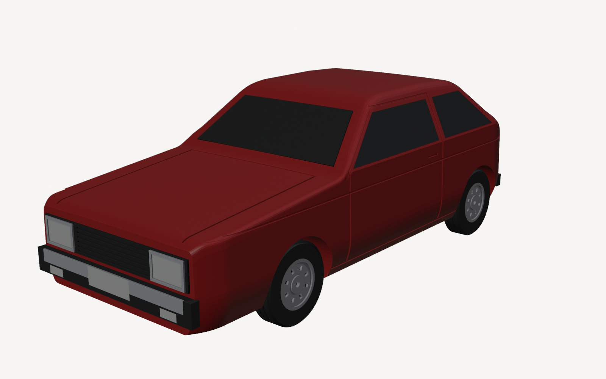

# Impressão 3D – Carros em Kit Card

Miniaturas de carros brasileiros em **kit card**, escala 1:32: todas as peças saem presas numa moldura, como os antigos kits de plastimodelismo, e você destaca e monta.

Tudo é gerado por script (Blender + Bambu Studio). A impressora-alvo é a **Bambu Lab A1 mini + AMS lite**, com bico 0,4, mesa texturizada e 4 cores fixas (vermelho, preto, prata, branco).

**Este repositório é um molde.** Para fazer um carro novo, preencha o [`PROMPT_NOVO_CARRO.md`](PROMPT_NOVO_CARRO.md) e cole no Claude Code com o repositório aberto. As regras e o fluxo estão no [`CLAUDE.md`](CLAUDE.md).

> **Nenhum modelo foi validado em impressão física ainda.** Veja o `VALIDACAO.md` de cada carro.

## Galeria

| | Carro | Arquitetura | Estimativa do fatiador | Status |
|---|---|---|---|---|
|  | [**VW Gol 1300 L 1980**](carros/gol_1980) | A: duas metades deitadas | 3h17 · ~80 g · 35 trocas | forma aprovada; falta imprimir |
|  | [**Puma GTS conversível**](carros/puma_gts) | B: inteiriça em pé | 3h24 · ~67 g · 50 trocas | aguardando aprovação da forma |

## Imprimir

1. **Uma vez, para todos os carros:** imprima o cupom [`calibracao/teste_folgas_A1mini.3mf`](calibracao/teste_folgas_A1mini.3mf) (1 cor, ~23 min). Leia os resultados, ajuste [`kitcard/fabricacao.py`](kitcard/fabricacao.py) e regere os carros.

   | Teste do cupom | Parâmetro |
   |---|---|
   | 7 furos, +0,10 a +0,40 mm no **diâmetro**: o pino entra **firme** | `HOLE_EXTRA`, `AXLE_WHEEL_EXTRA` |
   | … o pino **gira livre** | `AXLE_BODY_EXTRA` |
   | 3 rebaixos, 0,10 / 0,15 / 0,20 mm **por lado** | `PLATE_CLR` |
   | 3 pontos de destaque, 0,6 / 0,8 / 1,0 mm | `GATE_W` |
   | 3 vincos, 0,35 / 0,45 / 0,55 mm | `GROOVE_W` |

2. **O carro:** `carros/<carro>/saida/kitcard_A1mini.3mf`, com AMS nos slots 1 vermelho, 2 preto, 3 prata, 4 branco.

## Gerar (Windows)

Pré-requisitos: **Blender 5.0** e **Bambu Studio 2.05**, nos caminhos padrão.

```powershell
.\gerar.ps1 cupom
.\gerar.ps1 gol_1980
.\gerar.ps1 puma_gts
```

Cada execução:
1. extrai os perfis oficiais da A1 mini;
2. gera o carro e o cartão;
3. valida as malhas exportadas;
4. faz os renders;
5. fatia e confere o G-code.

Se qualquer portão falhar, o processo **para**.

## Estrutura

```
CLAUDE.md               regras + fluxo para fazer carros (lido pelo Claude Code)
PROMPT_NOVO_CARRO.md    formulário para pedir um carro novo
kitcard/                motor comum: fabricacao.py (folgas/mesa/cores), nucleo.py, gerar.py
carros/<carro>/         modelo.py, referencias.csv, README.md, VALIDACAO.md, saida/
calibracao/             cupom de folgas (comum a todos os carros)
bambu_perfis.py         perfis oficiais da A1 mini (inherits + include) + conferência do G-code
fatiar.py               fatia numa pasta temporária curta e verifica o G-code
gerar.ps1               faz tudo
bambu_cfg/              perfis gerados
CHANGELOG.md            histórico
```

## Como é feito (resumo)

1. **Pesquisa:** fotos do exemplar certo (ano e versão) e ficha técnica, registradas no `referencias.csv` com o nível de confiança.
2. **Carroceria:** um perfil lateral e centenas de seções transversais costuradas num sólido. Os detalhes (caixas de roda, vincos, rebaixos, furos) são cortados com o motor booleano **Manifold**.
3. **Arquitetura escolhida para imprimir sem suporte:**
   - **A, duas metades deitadas:** para carros fechados.
   - **B, inteiriça em pé:** para conversíveis.
4. **Cores planejadas para poucas trocas no AMS:**
   - detalhes coloridos com a face para baixo (acabamento liso) ou para cima (em relevo);
   - peças altas de outra cor sempre deitadas.
5. **Cartão:** as peças são distribuídas em linhas numa moldura de até 172 × 141 mm, deixando espaço para a torre de purga. Os pontos de destaque são criados automaticamente.
6. **Verificação:** STL reaberto e validado, fatiamento com os perfis oficiais e G-code conferido.

## Observações

- **Marcas:** "Gol", "Puma" e os logos são marcas de terceiros. Os modelos não têm emblemas. Para vender, avalie nomes genéricos na plaquinha e consulte alguém de propriedade intelectual.
- **Inmetro:** verifique o enquadramento (brinquedo × objeto de coleção) antes de vender.
- **Fotos de referência** são de terceiros e usadas só para estudo. Não estão no repositório.
