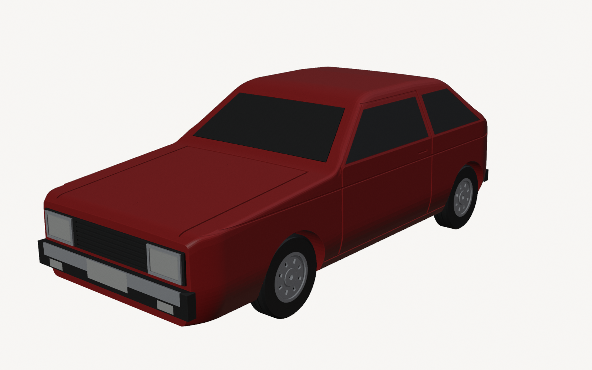
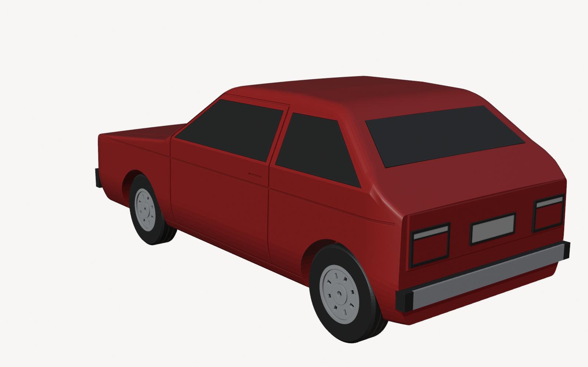
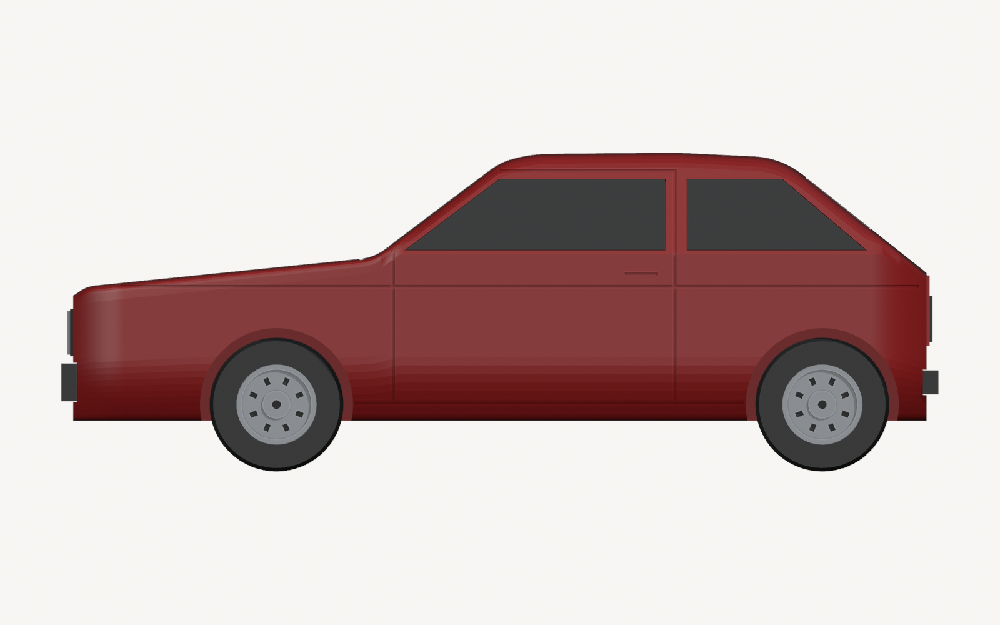
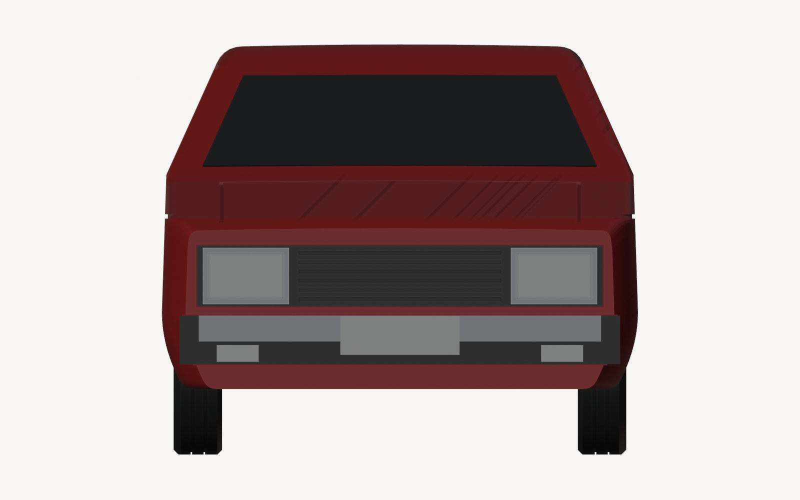
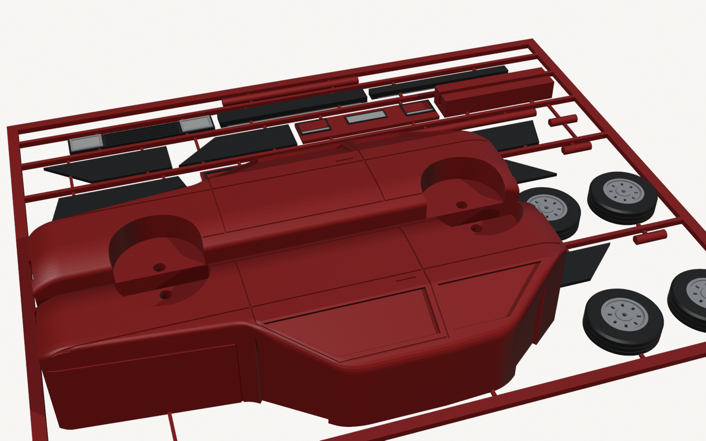
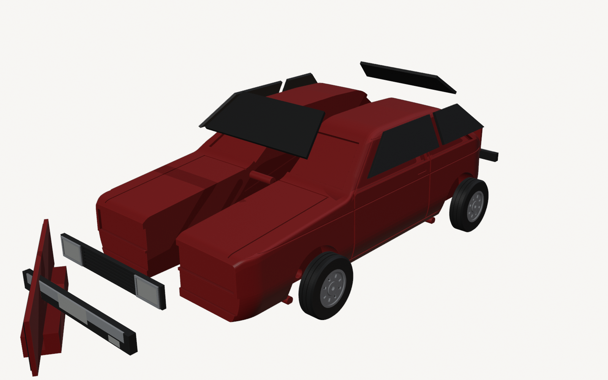
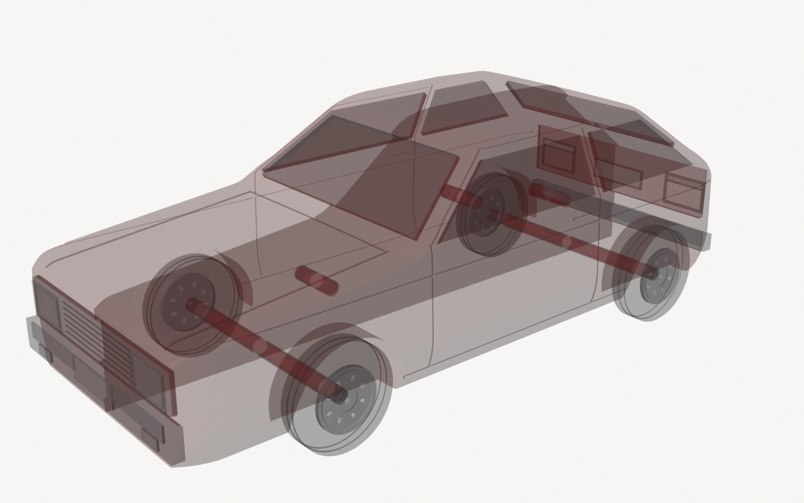

# Impressão 3D – Carros em Kit Card

Miniaturas de carros no estilo **kit card**: todas as peças saem impressas presas numa moldura, como os antigos kits de plastimodelismo. Você destaca e monta.

**Modelo atual:** VW **Gol 1300 L 1980** (1ª geração), vermelho, **escala 1:32** (118 mm). Projetado para a **Bambu Lab A1 mini + AMS lite**, com bico 0,4 e mesa texturizada.

> **Status v2: protótipo digital, ainda não impresso.**
> Perfis, G-code e malhas foram verificados automaticamente (detalhes em [VALIDACAO.md](VALIDACAO.md)). Encaixes, acabamento e aparência real **só serão confirmados na impressão física**. A v1 não foi liberada e está preservada só no histórico (tag `v1-nao-liberada`).

| Montado | Traseira |
|---|---|
|  |  |

| Vista lateral (ortográfica) | Vista frontal (ortográfica) |
|---|---|
|  |  |

| Cartão | Vista explodida | Raio-X: pinos e eixos |
|---|---|---|
|  |  |  |

---

## Para imprimir

**Antes de começar, confirme o equipamento:**
- impressora A1 mini com bico 0,4;
- mesa **Textured PEI**;
- PLA Basic nos slots do AMS: 1 vermelho, 2 preto, 3 prata, 4 branco.

Se algo for diferente, abra os STLs num projeto novo com o seu perfil em vez de usar os `.3mf` prontos.

1. **Cupom de calibração:** imprima [`saida/teste_folgas_A1mini.3mf`](saida/teste_folgas_A1mini.3mf) (1 cor, ~23 min, ~6 g). Ele tem 4 testes:

| Teste | Como ler | Parâmetro no `gol_kitcard.py` |
|---|---|---|
| 7 furos (10 a 40 = +0,10 a +0,40 mm no **diâmetro**) | furo onde o pino entra **firme** com o dedo | `HOLE_EXTRA` e `AXLE_WHEEL_EXTRA` |
| | furo onde o pino **gira livre**, sem folga visível | `AXLE_BODY_EXTRA` |
| 3 rebaixos (0,10 / 0,15 / 0,20 mm **por lado**) + plaquinha | o menor em que a plaquinha entra sem forçar | `PLATE_CLR` |
| 3 pontos de destaque (0,6 / 0,8 / 1,0 mm) | o que solta limpo, sem arrancar material | `GATE_W` |
| 3 vincos (0,35 / 0,45 / 0,55 mm) | o mais fino que aparece bem | `GROOVE_W` |

2. **Regere o modelo:** ajuste os valores no topo do `gol_kitcard.py` e rode `.\gerar_tudo.ps1`.
3. **Imprima o cartão:** [`saida/gol_kitcard_A1mini.3mf`](saida/gol_kitcard_A1mini.3mf). O fatiador estima **3h17** e **~80 g** (66 g vermelho, 10 g preto, 2 g prata, 2 g branco), com **35 trocas de cor**. São estimativas, não medições.

---

## Como foi feito

### Pesquisa

**Exemplar de referência:** o **Gol 1300 L 1980 vermelho da Garagem Volkswagen**, o primeiro Gol "placa preta". Fotos oficiais de frente e traseira estão em [VW News](https://www.vwnews.com.br/news/2699).

Todas as fontes, com o nível de confiança e o que foi usado de cada uma, estão em [`referencias/manifesto.csv`](referencias/manifesto.csv). As fotos de terceiros **não** estão no repositório nem podem ir para anúncios.

**Linha do tempo, para não misturar versões:**
- **1980:** faróis retangulares pequenos, lanternas pequenas nos cantos, para-choques cromados com pontas de borracha.
- **1985:** frente do Voyage, com faróis maiores e luz de direção.
- **1987:** reestilização (faróis, grade, lanternas, para-choques e rodas).
- **1994:** 2ª geração, a "bolinha".

**Medidas** (Gol L 1.3 1980, [ficha técnica, fonte secundária](https://www.fichacompleta.com.br/en/carros/volkswagen/gol-l-1-3-1980)). Nenhum desenho de fábrica foi encontrado, então estes números carregam essa incerteza:

| Medida | Real | 1:32 |
|---|---|---|
| Comprimento | 3790 mm | 118,4 mm |
| Largura | 1601 mm | 50,0 mm |
| Altura | 1375 mm | 43,0 mm |
| Entre-eixos | 2358 mm | 73,7 mm |
| Bitola dianteira / traseira | 1350 / 1366 mm | 42,2 / 42,7 mm |
| Pneu 155/80 R13 | Ø 578 × 155 mm | Ø 18,1 × 4,8 mm |

**Proporções estimadas a partir das fotos:**
- balanço dianteiro ~930 mm e traseiro ~500 mm (o motor longitudinal fica à frente do eixo);
- para-brisa da cota 1300 à 1850 (a partir da frente da carroceria);
- teto até ~3060;
- tampa traseira a ~38°.

### Software (gratuito)

| Software | Versão | Uso |
|---|---|---|
| Blender | 5.0.1 | Modelagem **por script Python**, sem abrir a interface. Booleanos com o motor **Manifold** |
| Python + NumPy | o que vem com o Blender / 3.12 | Geometria, validação de malha e verificação do G-code |
| Bambu Studio | 2.05.00.66 | Fatiamento por linha de comando, com os perfis oficiais da A1 mini |

### Como o modelo é construído ([`gol_kitcard.py`](gol_kitcard.py))

O script é dividido em seções: referência do veículo, fabricação, geometria, carroceria, peças, cartão, exportação/validação e render.

1. **Carroceria:** perfil lateral com cantos arredondados e 370 seções transversais (assoalho, lateral, linha de cintura, janelas inclinadas, teto abaulado) costuradas num sólido. Só a metade esquerda é modelada; a direita é o espelho.
2. **Cortes:**
   - caixas de roda e eixo passante;
   - furos dos pinos;
   - rebaixos dos vidros, da frente, do painel traseiro e dos para-choques;
   - vincos das portas, do capô, do friso lateral, da soleira e da maçaneta.
3. **Peças:**
   - 4 rodas de aço (pneu com sulcos, aro, prato, 8 fendas, cubo) e 2 eixos;
   - 6 vidros;
   - frente (faróis com aro, grade com frisos);
   - painel traseiro (lanternas, placa);
   - 2 para-choques;
   - plaquinha com pezinho;
   - 3 pinos.
4. **Cartão:** as peças são distribuídas em linhas, e os pontos de destaque são criados por raio até tocar a peça.
5. **Exportação:** uma malha unida por cor. O STL é **reaberto e validado**, e se houver defeito o processo para.

### Decisões de projeto

**Arquitetura de montagem.** Foram comparadas duas alternativas:

| | A: duas metades (escolhida) | B: casca + chassi |
|---|---|---|
| Suportes | nenhum (a superfície externa sempre "olha para cima") | cavidades e tetos internos exigem pontes ou suporte |
| Emenda visível | linha central no capô, teto e tampa | pode sumir nas linhas de painel |
| Peças | 23 | mais (chassi, casca, travas) |
| Risco / complexidade | baixo | maior (paredes finas, acesso) |
| Estilo kit card | igual ao B-17 de referência | menos parecido |

A foi escolhida porque é a única comprovadamente sem suporte e com menor risco. A emenda central fica registrada como ponto a avaliar na primeira impressão.

**Cores e custo:**
- **Relevo em cima:** frente, painel traseiro, rodas e plaquinha saem com a face de detalhe para cima.
- **Para-choques com a face para baixo:** assim a face cromada sai com o acabamento liso da mesa.
- **Onde ficam as trocas de cor:** as 4 cores só aparecem nas camadas 0–1 e 6, e da camada 24 em diante é só vermelho.

**Encaixes, cada um com sua folga:**
- **Carroceria:** 3 pinos justos.
- **Eixos:** passam pelas duas metades e **giram livres**.
- **Rodas:** **justas** no eixo. As duas rodas nas pontas impedem o eixo de sair.
- **Vidros:** placas em rebaixo. Talvez precisem de cola; só a impressão vai dizer.

**Limitações:**
- **Piscas:** são brancos, porque o AMS lite tem só 4 slots e o âmbar seria uma 5ª cor.
- **Não modelados nesta versão:**
  - retrovisor, limpadores, calhas e tampa de combustível;
  - logo e emblemas (por causa da marca).

---

## Estrutura

```
gol_kitcard.py       modelo, cartão, validação de malha e renders (Blender)
teste_folgas.py      cupom de calibração (importa gol_kitcard; verifica os furos)
bambu_perfis.py      extrai os perfis oficiais da A1 mini (resolve inherits + include) e confere o G-code
fatiar.py            fatia cupom e cartão e confere o G-code gerado -> saida/fatiamento.json
gerar_tudo.ps1       roda tudo em sequência
bambu_cfg/           perfis usados (gerados pelo bambu_perfis.py)
referencias/         manifesto das fontes
saida/               3MF fatiados, STLs por cor, .blend, renders, cartao.json, fatiamento.json
CHANGELOG.md         o que mudou e por quê (ligado aos itens da auditoria)
VALIDACAO.md         o que foi verificado, em que nível, e o que falta
```

## Regenerar

Com o Blender 5.0 e o Bambu Studio instalados nos caminhos padrão, rode:

```powershell
.\gerar_tudo.ps1
```

Qualquer falha de perfil, malha, cupom ou G-code interrompe o processo.

## Observação sobre marca

"Gol" e o logo VW são marcas da Volkswagen. O modelo não tem logo. Para vender, avalie trocar `NAME_TEXT` por um nome genérico e consulte alguém de propriedade intelectual. Verifique também o enquadramento no Inmetro: brinquedo × objeto de coleção.
