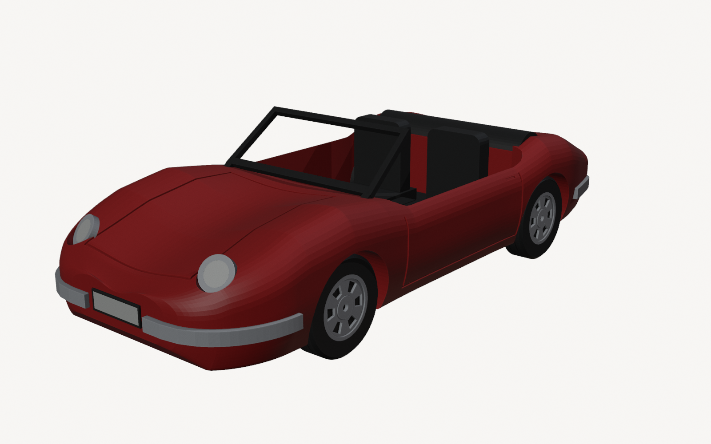
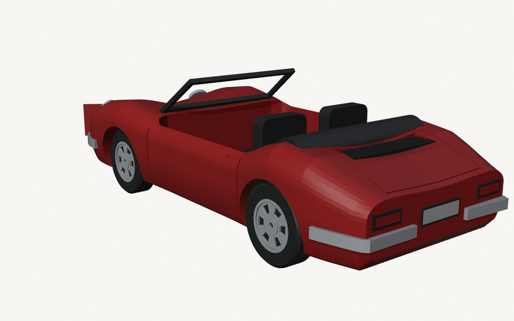
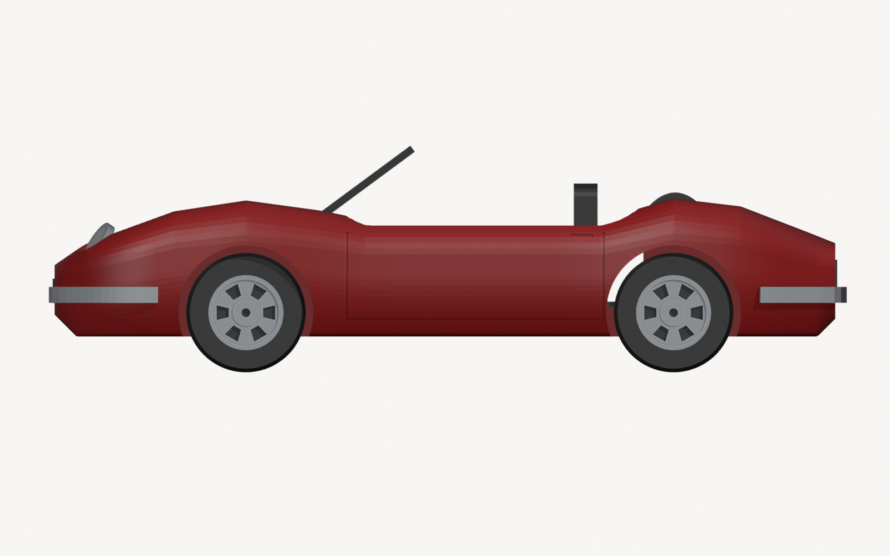
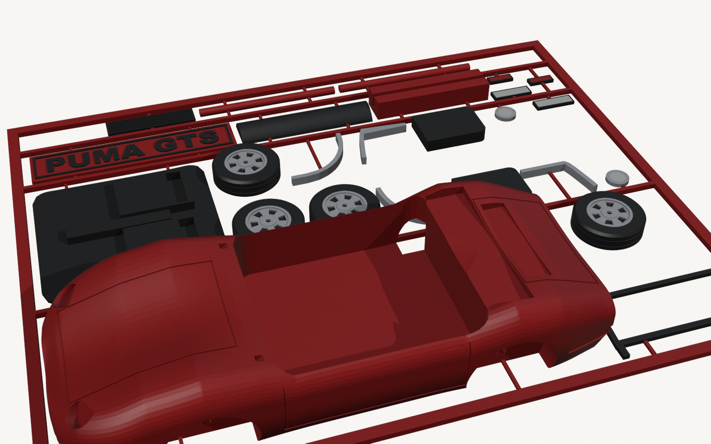
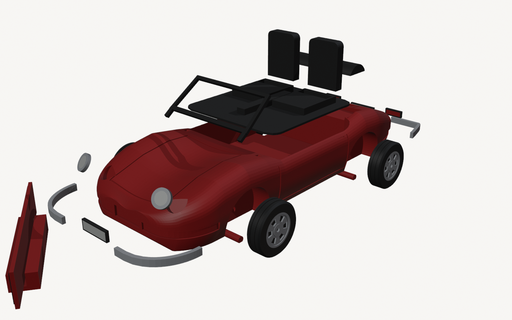
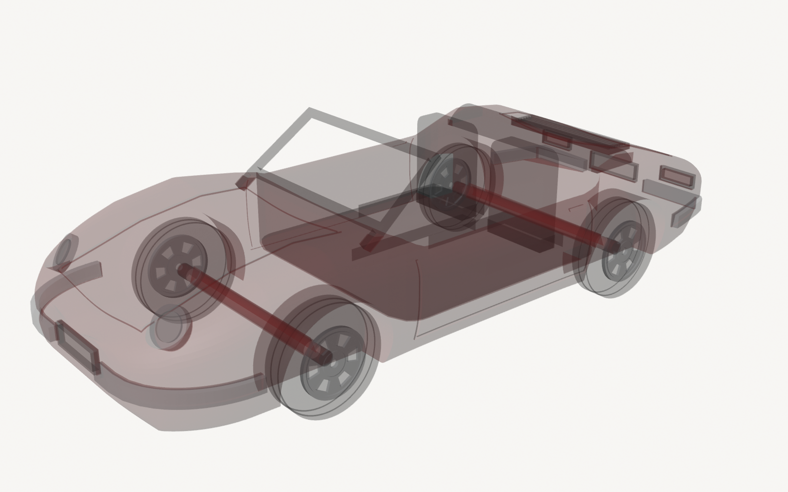

# Puma GTS conversível — 1:32

Esportivo brasileiro de fibra de vidro, com mecânica VW 1600 a ar e motor traseiro (1973–1981). Nesta escala tem 125 mm de comprimento.

> **Status: protótipo digital, ainda não impresso.** A forma aguarda a aprovação do dono. Detalhes da verificação em [VALIDACAO.md](VALIDACAO.md).

| Montado | Traseira |
|---|---|
|  |  |

| Lateral (ortográfica) | Cartão |
|---|---|
|  |  |

| Vista explodida | Raio-X: eixos |
|---|---|
|  |  |

## Imprimir

Abra [`saida/kitcard_A1mini.3mf`](saida/kitcard_A1mini.3mf). Configuração do AMS: 1 vermelho, 2 preto, 3 prata, 4 branco. É a mesma do Gol, então não precisa trocar bobina.

Antes, imprima o cupom de calibração ([`calibracao/`](../../calibracao)). Ele vale para todos os carros.

Estimativa do fatiador (não é medição):

| Tempo | Filamento | Trocas de cor | Cartão |
|---|---|---|---|
| 3h24 | ~67 g (46,5 vermelho · 13,7 preto · 5,3 prata · 1,7 branco) | 50 | 172 × 139 mm |

## Referências e medidas

Fontes em [`referencias.csv`](referencias.csv).

| Medida | Real | 1:32 | Fonte |
|---|---|---|---|
| Comprimento | 4000 mm | 125 mm | Wikipédia |
| Largura | 1665 mm | 52 mm | Wikipédia |
| Entre-eixos | 2150 mm | 67,2 mm | Wikipédia |
| Balanço dianteiro / traseiro | ~1000 / ~850 mm | — | estimado da foto lateral |
| Pneu | 175/70 R14 (Ø 600 mm) | Ø 18,8 × 5,5 mm | aro 14 confirmado; medida **estimada** |
| Bitolas | 1340 / 1380 mm | — | **estimadas** |

## Arquitetura: B, carroceria inteiriça em pé

O Gol usa duas metades deitadas, o que funciona para carro fechado. Num conversível, o cockpit aberto viraria um balanço enorme nas metades.

Em pé, o cockpit é um bolsão aberto para cima, com paredes verticais. Por isso a carroceria sai **sem suporte**:
- **Fundo:** plano, com chanfro de 45° no bico e na traseira.
- **Laterais:** recolhimento inferior ≤ 26° da vertical.
- **Eixos:** furos em gota (topo a 45°).
- **Caixas de roda:** a curva de cima forma uma ponte de ~15 mm no fatiador.

## Peças (25)

| Peça | Cor | Como imprime | Como monta |
|---|---|---|---|
| Carroceria | vermelho | em pé | — |
| 4 rodas de liga (6 janelas, aro destacado, cubo) + 2 eixos passantes | preto + prata / vermelho | face externa para cima / deitados | o eixo atravessa a carroceria; as rodas entram justas nas pontas |
| Base dos bancos (assentos, túnel, soquetes) | preto | em pé (3,4 mm) | assenta no piso do cockpit |
| 2 encostos | preto | **deitados** | encaixam nos soquetes |
| Moldura do para-brisa | preto | deitada | as 2 pernas entram em furos inclinados no painel |
| Capota recolhida | preto | deitada | assenta no rebaixo atrás do cockpit |
| Grade do motor (7 frisos) | preto | face-up | rebaixo na tampa do motor |
| 2 faróis (aro prata + lente branca) | prata + branco | face-up | rebaixo nos para-lamas |
| 2 lanternas (moldura preta + lente vermelha) | preto + vermelho | face-up | rebaixo na traseira |
| 2 placas | branco + preto | face-up | rebaixo na frente e na traseira |
| 4 lâminas de para-choque | prata | em pé | rebaixo de 0,5 mm na carroceria (**provavelmente com cola**) |
| Plaquinha "PUMA GTS" (12 mm) + pezinho | vermelho + preto | — | — |

## Decisões e aprendizados

- **Encostos separados e deitados.** Com os bancos inteiros em pé (19 mm de preto ao lado do vermelho), o fatiador dava **120 trocas de cor e 5h29**. Deitando os encostos, caiu para **50 trocas e 3h24**.
- **Corcundas dos para-lamas acima da linha da porta:** é a assinatura visual do Puma.
- **Para-brisa só com a moldura**, sem vidro: preto opaco num conversível ficaria estranho.
- **Plaquinha de 12 mm**, para o cartão caber em 141 mm.

## Limitações e pendências

- **Não modelados:**
  - retrovisor (só na porta do motorista, conforme foto), volante e painel de instrumentos;
  - piscas dianteiros âmbar (exigiriam uma 5ª cor);
  - emblema do Puma e letreiros (marca).
- **Medidas estimadas:** pneu, bitolas e alturas dos perfis, tiradas de fotos em perspectiva.
- **Precisa de impressão física para confirmar:**
  - ponte das caixas de roda;
  - furos inclinados do para-brisa;
  - retenção das lâminas de para-choque (provavelmente com cola);
  - acabamento das superfícies de cima (degraus de camada no capô e na tampa a 0,20 mm; talvez valha 0,12 mm).
- **Venda:** "Puma" é marca; avalie `NAME_TEXT` genérico.
